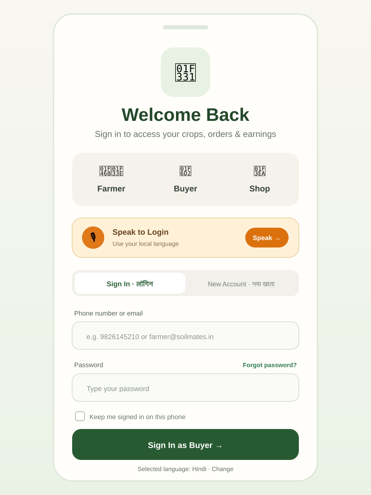
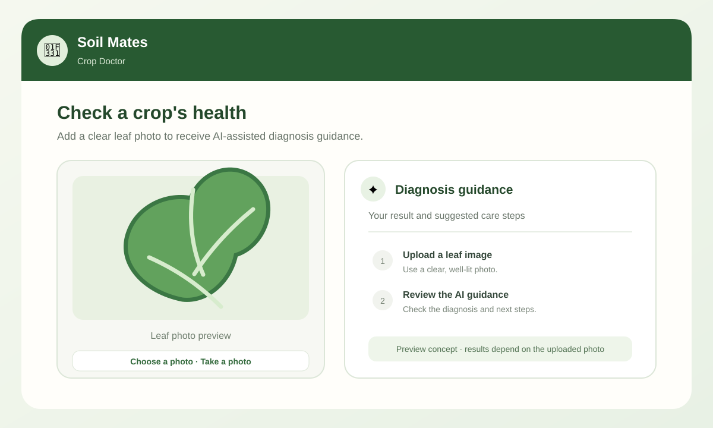

# 🌱 Soil Mates - Agricultural Marketplace & AI Crop Doctor

Soil Mates is a full-stack React and TypeScript app for India's agricultural community, built with Vite, Express, MongoDB, and Capacitor for Android. It brings together AI-assisted crop diagnosis, mandi price trends and alerts, farmer/buyer/vendor experiences, voice access in English and Hindi, biometric unlock, and Android APK build tools.
---

## 📱 Features

- **Role-based entry**: Farmer, buyer, and shop/trader sign-in and account creation flows.
- **AI Crop Doctor**: Gemini-assisted leaf disease diagnosis with a diagnosis history.
- **Mandi market trends**: Interactive seven-day commodity price charts and profile alerts for price changes.
- **Voice and languages**: English and Hindi support, speech synthesis, and voice-assisted access.
- **Biometric unlock**: Fingerprint and Face ID support on compatible devices.
- **PWA and Android**: Installable web app, Capacitor Android wrapper, downloadable APK, and Gradle build scripts.

## 🖼️ App previews

These preview illustrations show the sign-in flow and Crop Doctor workflow. They are UI previews; the final screens may vary by device and app version.

| Sign-in | Crop Doctor |
| --- | --- |
|  |  |
---

## 🛠️ System Prerequisites & Setup Guide

To successfully build and run Soil Mates for Android, you need to install and configure the following developer tools:

### 1. Node.js & npm
- Download and install **Node.js LTS (v18 or v20+)** from [nodejs.org](https://nodejs.org/).
- Verify installation:
  ```bash
  node -v
  npm -v
  ```

### 2. Java Development Kit (JDK 17 or 21)
- Download and install **JDK 17 or JDK 21** (e.g., Eclipse Temurin or Azul Zulu) from [Adoptium](https://adoptium.net/).
- Set up the `JAVA_HOME` environment variable:
  - **Windows**: Add `JAVA_HOME` pointing to your JDK installation path (e.g., `C:\Program Files\Eclipse Adoptium\jdk-17...`) and add `%JAVA_HOME%\bin` to your System `PATH`.
  - **macOS / Linux**: Export `JAVA_HOME` in your `~/.bashrc` or `~/.zshrc`:
    ```bash
    export JAVA_HOME=/Library/Java/JavaVirtualMachines/temurin-17.jdk/Contents/Home
    export PATH=$PATH:$JAVA_HOME/bin
    ```

### 3. Android Studio & Android SDK
- Download and install **Android Studio** from [developer.android.com](https://developer.android.com/studio).
- During setup, ensure you install:
  - **Android SDK**
  - **Android SDK Platform-Tools**
  - **Android SDK Build-Tools**
- Set up the `ANDROID_HOME` environment variable:
  - **Windows**: `C:\Users\<YourUsername>\AppData\Local\Android\Sdk`
  - **macOS**: `/Users/<YourUsername>/Library/Android/sdk`
  - **Linux**: `/home/<YourUsername>/Android/Sdk`
  - Add `platform-tools` and `tools` to your system `PATH`.

---

## ⚙️ Environment Variables (`.env.example`)

Create a `.env` file in the project root based on `.env.example`:

```env
# Backend Server & Database
PORT=4000
MONGO_URI=mongodb://localhost:27017/soil-mates
JWT_SECRET=your_super_secret_jwt_key_here
ADMIN_API_KEY=your_admin_api_key_here

# Google Gemini AI (Server-side only - never expose in frontend)
GEMINI_API_KEY=your_gemini_api_key_here

# Frontend Public API URL
VITE_API_BASE_URL=http://localhost:4000
```

---

## 🚀 Quick Start & Development

1. **Install Dependencies**:
   ```bash
   npm install
   ```

2. **Run Web Development Server**:
   ```bash
   npm run dev
   ```

3. **Build Web App**:
   ```bash
   npm run build
   ```

---

## 🤖 Building the Android APK

For detailed environment variable configurations (`JAVA_HOME`, `ANDROID_HOME`), VS Code path resolution, and troubleshooting, see **[BUILD_GUIDE.md](./BUILD_GUIDE.md)**.

### Automatic APK Build Scripts
- **Full Standalone Package**:
  ```bash
  npm run build:apk
  ```
  * *Output*: `/SoilMates.apk` (~32.4 MB ready-to-install package)

- **Gradle Release APK (`assembleRelease`)**:
  ```bash
  npm run build:apk:release
  ```
  * *Output*: `android/app/build/outputs/apk/release/app-release.apk` (or `app-release-unsigned.apk`)

- **Gradle Debug APK (`assembleDebug`)**:
  ```bash
  npm run build:apk:debug
  ```
  * *Output*: `android/app/build/outputs/apk/debug/app-debug.apk`

---

### Manual Gradle Build Instructions (Windows / macOS / Linux)

1. **Build Web App & Synchronize Capacitor**:
   ```bash
   npm run build
   npx cap sync android
   ```

2. **Navigate to the Android Folder**:
   ```bash
   cd android
   ```

3. **Generate Release APK (`gradlew assembleRelease`)**:
   - **Windows**: `gradlew.bat assembleRelease`
   - **macOS / Linux**: `./gradlew assembleRelease`
   * *Output*: `android/app/build/outputs/apk/release/app-release.apk`

4. **Generate Debug APK (`gradlew assembleDebug`)**:
   - **Windows**: `gradlew.bat assembleDebug`
   - **macOS / Linux**: `./gradlew assembleDebug`
   * *Output*: `android/app/build/outputs/apk/debug/app-debug.apk`

---

## 📂 Project Structure

```text
src/
  components/    # React UI components (Login, HomeScreen, MarketPriceTrend, etc.)
  services/      # API client & biometric auth services
  types.ts       # TypeScript interfaces & types
  App.tsx        # Main application router with Framer Motion transitions

server/
  src/
    config/      # Database configuration
    models/      # Mongoose schemas (User, Product, Order, Diagnosis, etc.)
    routes/      # Express API endpoints

android/         # Capacitor Android native wrapper project
docs/            # Project documentation & architecture specs
```

---


